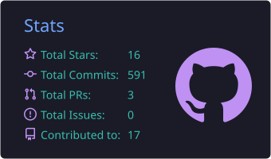
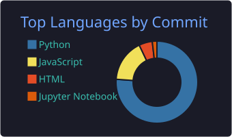
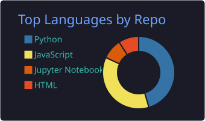
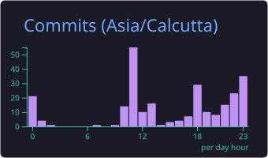

Dharmi Sandip Sapariya

Computer Science Engineering | AI/ML | Full-Stack Development

I build practical software at the intersection of AI, machine learning, backend engineering, and real-world problem solving. Interested in building systems that are reliable, measurable, and useful beyond the demo.

⸻

🚀 Featured Projects

NextSkill

Career intelligence for the tech job market, built for individuals instead of enterprises. Job postings from two sources are ingested into PostgreSQL, skills are extracted with NLP, and the dashboard recommends what to learn next. Every number traces back to real postings.

30+ API endpoints · 156 tests · CI on every push

Python FastAPI PostgreSQL Redis Docker spaCy Streamlit

Kavach

Free deepfake detection for women in India. A 4-signal pipeline scores any image or video, then helps the user act: it generates a pre-filled FIR draft, writes platform takedown reports, and supports a WhatsApp bot for quick checks.

React Tailwind FastAPI PyTorch OpenCV

WalletWise

Full-stack personal finance dashboard with an AI coach that reads the user’s real transaction data. Includes server-side analytics (trend regression, anomaly detection, Monte-Carlo budget forecasting) and the Claude API integration runs on the backend so keys never reach the browser.

44 automated tests · Docker Compose · GitHub Actions CI

React Node.js Express PostgreSQL Claude API

NeuraVapor

Engineering Clinics capstone: a closed-loop prototype that turns data-center waste heat into distilled water using membrane distillation, with noise-adaptive control and a live 3D digital twin in the browser. Built on a budget of about INR 6,000 to 7,000.

Raspberry Pi Python Three.js Sensors

Amazon ML Challenge 2026: Business Entity Resolution

Two-stage pipeline for matching noisy business records: high-recall candidate generation, then hard-negative matching. I built the data engineering and blocking stage, which reached 92.35% blocking recall on the validation sample, up from about 24% for the first baseline.

Python Pandas RapidFuzz scikit-learn LightGBM

⸻

🛠️ More Projects

Project	What it is	Stack
SafeBite	Allergen-aware food label scanner: OCR, personal diet profile, safe / flagged / unclear verdicts, and swap suggestions	FastAPI OCR JavaScript
ResourceRX	Peer-to-peer medical equipment sharing network with clinic, owner, technician and logistics portals and a local Ollama assistant	React Vite Node.js Ollama
BorderEye	Arduino intrusion detection that fuses ultrasonic, metal, gas and temperature sensors with Bluetooth alerts	Arduino C++

⸻

🏅 Certifications and Learning

	
OCI Generative AI Professional	Labs, runbooks and 300+ practice questions covering LLMs, RAG with LangChain and Oracle 23ai, and GenAI Agents
JPMorgan Chase Quantitative Research	Forage simulation: natural gas price estimation and contract pricing, loan default prediction, FICO score bucketing
Kaggle: Intro to Machine Learning	Notes and notebooks on decision trees and random forests
SQL practice	LeetCode SQL solutions, updated as I go

⸻

🧰 Tech Stack

	
Languages	
Frameworks & Libraries	
AI & ML	

 scikit-learn spaCy LangChain Transformers MediaPipe

Data & Infra	
Hardware	
Design	
IDEs	
Tools	

⸻

🏆 GitHub Achievements

  

⸻

🔥 Contribution Streak

  

⸻

📊 GitHub Statistics

  
  

  
  

⸻

  

