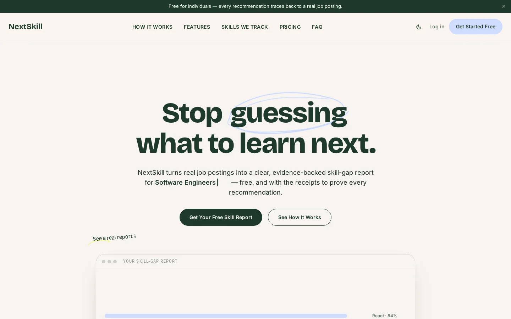
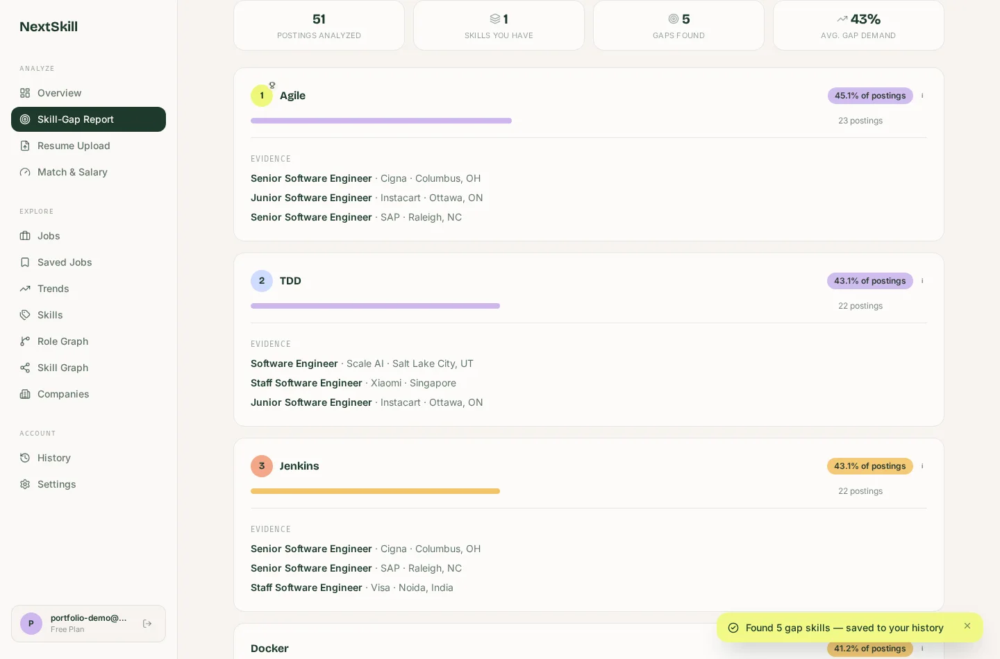
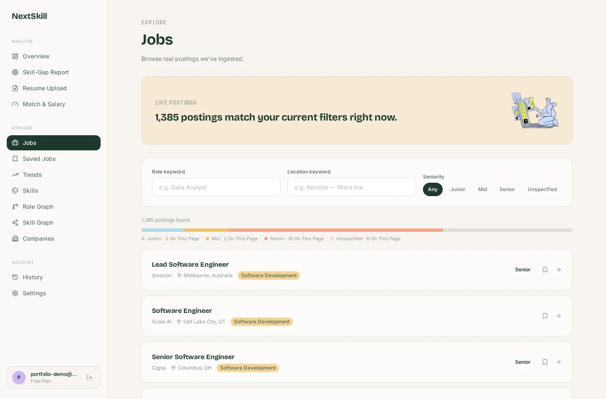

[LinkedIn](https://www.linkedin.com/in/dharmi-sapariya-b98754390/) · [Current work](#current-work) · [Projects](#projects) · [Credentials](#credentials) · [Tools](#tools-and-technologies) · [GitHub activity](#github-activity)

I’m a B.Tech Computer Science and Engineering student at VIT-AP University, specializing in AI and Machine Learning. I like working across the stack, from the interface and API to the data behind them. Outside software, I’m interested in finance, especially markets, quantitative research, and risk.

## Current work

### [NextSkill](https://github.com/DharmiSapariya/NextSkill)

NextSkill is a career intelligence platform in development. It uses job postings to help people see which skills employers ask for, identify gaps in their own experience, and decide what to learn next.

- **Job-market data.** An ingestion pipeline collects postings from Adzuna and RemoteOK. A skill taxonomy and NLP extraction turn job descriptions into searchable skill data.
- **Career tools.** The app brings together skill-gap reports, résumé analysis, job matching, salary estimates, and role and skill graphs.
- **Stack.** React, FastAPI, PostgreSQL, Redis, and Python. The repository also includes a Streamlit dashboard for exploring the data.

Landing page captured from the locally running React build.

<strong>Expand the NextSkill product walkthrough</strong>

I ran the React app against its FastAPI backend and a local PostgreSQL database. The screens below use **seeded demo data**. The example listings, employers, and demand percentages shown are illustrative.

**Skill-gap report** · Choose a target role, enter your current skills, and run the report. In this example, the app compares Python against software engineering postings and ranks the missing skills by how often they appear. Each recommendation shows example postings from the demo dataset.

**Jobs browser** · Explore the postings behind the analysis. Filter by role, location, or seniority, and open a listing to inspect its details.

## Projects

| Build | What it does | What to look for |
| --- | --- | --- |
| [**Amazon ML Challenge**](https://github.com/DharmiSapariya/Amazom_ML_Challenge_2026) | Matches business records across noisy datasets. | My work on normalization, candidate generation, and missed-match analysis. The team used LightGBM to score candidate pairs. |
| [**WalletWise**](https://github.com/DharmiSapariya/WalletWise) | Helps users track spending, set budgets, and explore cash-flow forecasts. | In-development React app with a PostgreSQL-backed API, transaction analytics, and an AI coach. |
| [**GroundGate**](https://github.com/DharmiSapariya/GroundGate) | Checks an AI agent’s assumptions against source records before acting. | Hackathon prototype with a second check at database write time and a replay of synthetic scenarios. |
| [**MongoDB AI Agent Platform**](https://github.com/DharmiSapariya/AI-Agents-with-MongoDB-Certification) | Lets users inspect source citations and replay agent execution. | Scripted workspace demo and a separate Mentor that explains execution traces. Live retrieval evaluation is pending. |
| [**Kavach**](https://github.com/DharmiSapariya/Kavach) | Combines detection signals for reviewing suspected deepfake images and videos. | Prototype exploring how detection scores can support reporting. |
| [**SafeBite**](https://github.com/DharmiSapariya/SafeBite) | Reads food labels and checks ingredients against dietary preferences. | OCR, allergen screening, and suggested alternatives. |
| [**ResourceRX**](https://github.com/DharmiSapariya/ResourceRX) | Explores equipment sharing between clinics, owners, and service partners. | Medical equipment leasing concept with workflows for each participant. |
| [**Legal Guard**](https://github.com/DharmiSapariya/Legal_Guard-features) | Explores scheduling and case intake workflows for legal services. | Backend modules for meetings, transcripts, grievance intake, and public-interest litigation groups. |
| [**NeuraVapor**](https://github.com/DharmiSapariya/NeuraVapor) | Explores recovering water from waste heat using membrane distillation. | Capstone prototype with sensor feedback and a browser-based 3D digital twin. |
| [**Border Eye**](https://github.com/DharmiSapariya/BorderEye) | Combines proximity, metal, and environmental sensors on Arduino. | Coursework prototype with local readings and Bluetooth alerts. |

## Credentials

| Credential | Focus | Evidence |
| --- | --- | --- |
| **AWS Certified Solutions Architect – Associate** | Secure, resilient, and cost-aware cloud architecture. Issued Nov 2026, valid through Nov 2029. | [Certificate and study notes](https://github.com/DharmiSapariya/aws-solutions-architect-associate-certification) · [AWS verification](https://aws.amazon.com/verification) |
| **Oracle Cloud Infrastructure 2025 Certified Generative AI Professional** | OCI Generative AI, language models, embeddings, and retrieval-augmented generation. Issued Jul 2026, valid through Jul 2028. | [Labs and runbooks](https://github.com/DharmiSapariya/Oracle-Cloud-Infrastructure-Generative-AI-Professional-Certification) |
| **Building AI Agents with MongoDB** | Agent workflows, retrieval, and execution traces. Issued Nov 2026. | [Verified skill badge](https://www.credly.com/badges/9b5d068b-0566-479f-812b-93b06d01041b) · [Agent platform](https://github.com/DharmiSapariya/AI-Agents-with-MongoDB-Certification) |
| **JPMorgan Chase & Co. Quantitative Research Job Simulation** | Commodity pricing, credit-risk modeling, and FICO score bucketing. Completed Jul 2026 through Forage. | [Exercises and certificate](https://github.com/DharmiSapariya/jpmc_quant_research_certification) |
| **Kaggle Intro to Machine Learning** | Model validation, decision trees, and random forests. Completed Feb 2026. | [Course notebooks](https://github.com/DharmiSapariya/Kaggle-Intro-to-Machine-Learning) |

[SQL practice on LeetCode](https://github.com/DharmiSapariya/SQL-LeetCode)

## Tools and technologies

| Area | Logos | Tools |
| --- | --- | --- |
| **Languages** |  | Python, JavaScript, TypeScript, Java, C++, HTML, CSS, SQL |
| **Frontend and design** |  | React, Tailwind CSS, Vite, Figma, Streamlit, Three.js |
| **Backend and APIs** |  | FastAPI, Flask, Node.js, Express |
| **Machine learning and AI** |  | PyTorch, OpenCV, scikit-learn, pandas, NumPy, LightGBM, spaCy, RapidFuzz, LangChain, LangGraph, Transformers, MediaPipe |
| **Databases and caching** |  | PostgreSQL, MongoDB, MongoDB Atlas, Redis |
| **Cloud and development** |  | AWS, Oracle Cloud Infrastructure, Docker, Git, GitHub, GitHub Actions |
| **Hardware** |  | Raspberry Pi, Arduino |
| **Editors and IDEs** |  | VS Code, PyCharm, IntelliJ IDEA |

## GitHub activity

  

[Contribution calendar](https://github.com/DharmiSapariya#js-contribution-activity)

## Git-koi

  

[git-koi](https://github.com/yalongwastaken/git-koi) by [@yalongwastaken](https://github.com/yalongwastaken) renders public GitHub activity as a pixel-art koi. Languages influence the palette, contributions influence growth, and streaks and recent activity affect details and motion. [Koi refresh history](https://github.com/DharmiSapariya/DharmiSapariya/actions/workflows/koi.yml)
