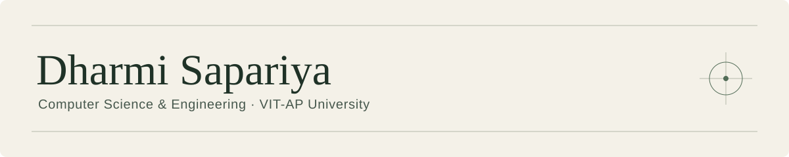
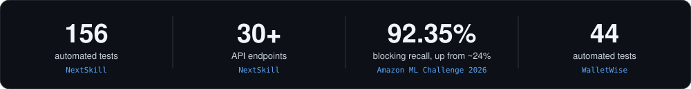
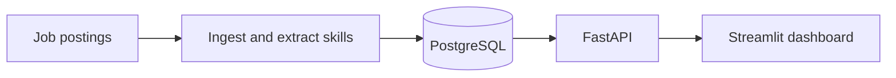
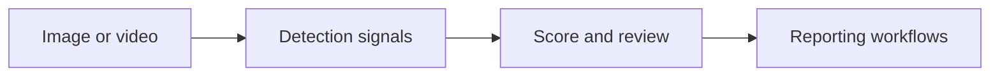
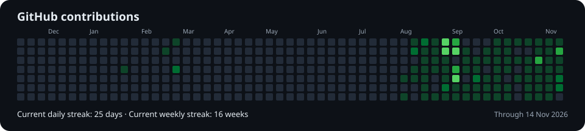

[Projects](#selected-projects) · [Credentials](#credentials) · [Tools](#tools-and-technologies) · [Activity](#github-activity) · [Koi](#git-koi)

## About

I’m a B.Tech Computer Science and Engineering student at VIT-AP University (2024–2028), specializing in Artificial Intelligence and Machine Learning. I enjoy building across the stack, from interfaces and APIs to data pipelines and model evaluation. I’m also interested in finance, particularly markets, quantitative research, and how software can support better financial decisions.

## Selected projects

The numbers above come from the project repositories. The entity-resolution figure measures candidate retrieval on the documented validation sample. Several projects are still being developed.

| Project | What it explores | Evidence and status |
| --- | --- | --- |
| **[Amazon ML Challenge — Business Entity Resolution](https://github.com/DharmiSapariya/Amazom_ML_Challenge_2026)** | Matching noisy business records with multi-key candidate generation and a LightGBM matcher | I worked on normalization, blocking experiments, and missed-match analysis. The repository includes scripts, trained model files, and [experiment reports](https://github.com/DharmiSapariya/Amazom_ML_Challenge_2026/tree/main/reports). |
| **[NextSkill](https://github.com/DharmiSapariya/NextSkill)** | Job-market intelligence from postings, NLP skill extraction, and a dashboard for exploring skill demand | In development. Python, FastAPI, PostgreSQL, Redis, spaCy, and Streamlit. |
| **[WalletWise](https://github.com/DharmiSapariya/WalletWise)** | Full-stack personal finance dashboard with budgeting, spending analytics, and an AI coach | In development. React, Express, PostgreSQL, and server-side analytics. |
| **[GroundGate](https://github.com/DharmiSapariya/GroundGate)** | Checking an AI agent’s assumptions against source records before an action executes | Hackathon prototype with a scenario replay and documented synthetic evaluation. |
| **[MongoDB AI Agent Platform](https://github.com/DharmiSapariya/AI-Agents-with-MongoDB-Certification)** | A workspace for inspecting an agent’s citations, replaying its execution, and learning how it works | Scripted demo and test evidence are documented. Live retrieval evaluation is pending. |
| **[Kavach](https://github.com/DharmiSapariya/Kavach)** | A deepfake detection prototype combining multiple signals with reporting workflows | React, FastAPI, PyTorch, and OpenCV. |
| **[NeuraVapor](https://github.com/DharmiSapariya/NeuraVapor)** | A capstone prototype exploring waste-heat recovery, membrane distillation, sensor feedback, and a 3D digital twin | Hardware and software prototype. Raspberry Pi, Python, and Three.js. |

### Project checks

<b>Architecture diagrams</b>

**NextSkill**

**Kavach**

**Business entity resolution**

[Recall at different candidate limits](https://github.com/DharmiSapariya/Amazom_ML_Challenge_2026/blob/main/docs/diagrams/recall_at_k.svg) · [Results](https://github.com/DharmiSapariya/Amazom_ML_Challenge_2026/blob/main/docs/diagrams/results.svg) · [Error breakdown](https://github.com/DharmiSapariya/Amazom_ML_Challenge_2026/blob/main/docs/diagrams/loss_breakdown.svg)

<b>More projects and experiments</b>

| Project | Focus |
| --- | --- |
| [SafeBite](https://github.com/DharmiSapariya/SafeBite) · [Team repository](https://github.com/Jasmine0987/safebite) | Food-label OCR, allergen screening, and swap suggestions |
| [ResourceRX](https://github.com/DharmiSapariya/ResourceRX) | Medical equipment sharing and leasing concept |
| [Legal Guard](https://github.com/DharmiSapariya/Legal_Guard-features) | Legal Guard feature development |
| [Border Eye](https://github.com/DharmiSapariya/BorderEye) | Arduino multi-sensor coursework prototype |

## Credentials

| Credential | Issued | Work and verification |
| --- | --- | --- |
| **AWS Certified Solutions Architect – Associate** | Nov 2026 · Expires Nov 2029 | [Study notes and certificate](https://github.com/DharmiSapariya/aws-solutions-architect-associate-certification) · [AWS verification](https://aws.amazon.com/verification) |
| **Oracle Cloud Infrastructure 2025 Certified Generative AI Professional** | Jul 2026 · Expires Jul 2028 | [Labs and runbooks](https://github.com/DharmiSapariya/Oracle-Cloud-Infrastructure-Generative-AI-Professional-Certification) |
| **Building AI Agents with MongoDB** | Nov 2026 | [Skill badge](https://www.credly.com/badges/9b5d068b-0566-479f-812b-93b06d01041b) · [Agent platform](https://github.com/DharmiSapariya/AI-Agents-with-MongoDB-Certification) |
| **JPMorgan Chase & Co. Quantitative Research Job Simulation** | Jul 2026 | Issued by Forage. [Pricing and credit-risk exercises](https://github.com/DharmiSapariya/jpmc_quant_research_certification) · [Certificate](https://github.com/DharmiSapariya/jpmc_quant_research_certification/blob/main/docs/JPMorgan_Chase_certificate.pdf) |
| **Kaggle Intro to Machine Learning** | Feb 2026 | [Course notebooks and notes](https://github.com/DharmiSapariya/Kaggle-Intro-to-Machine-Learning) |

[SQL practice on LeetCode](https://github.com/DharmiSapariya/SQL-LeetCode)

## Tools and technologies

| Area | Tools I’ve used |
| --- | --- |
| Languages | Python, SQL, JavaScript, TypeScript, Java, C++, HTML, CSS |
| Web and backend | React, Tailwind CSS, Node.js, Express, FastAPI, Flask, Streamlit |
| Data and ML | pandas, NumPy, scikit-learn, LightGBM, PyTorch, OpenCV, spaCy, RapidFuzz |
| AI applications | LangGraph, LangChain, MongoDB Atlas, Transformers, MediaPipe |
| Data and infrastructure | PostgreSQL, MongoDB, Redis, Docker, GitHub Actions, AWS, OCI |
| Hardware, design, and tools | Raspberry Pi, Arduino, Three.js, Figma, Git, GitHub, VS Code, PyCharm, IntelliJ IDEA |

## GitHub activity

  

  
  
  
  

[Contribution calendar](https://github.com/DharmiSapariya#js-contribution-activity) · [Profile card refresh history](https://github.com/DharmiSapariya/DharmiSapariya/actions/workflows/profile-summary-cards.yml)

## Git-koi

  

[git-koi](https://github.com/yalongwastaken/git-koi) by [@yalongwastaken](https://github.com/yalongwastaken) renders public GitHub activity as a pixel-art koi. Languages influence the palette, contributions influence growth, and streaks and recent activity affect details and motion. [Koi refresh history](https://github.com/DharmiSapariya/DharmiSapariya/actions/workflows/koi.yml)
