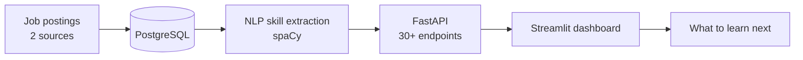
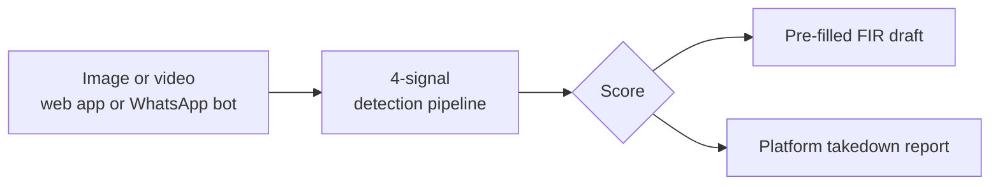

 

**[Selected work](#selected-work)** · **[Architecture](#how-two-of-them-work)** · **[Activity](#activity)** · **[git-koi](#git-koi)** · **[Learning](#certifications-and-learning)** · **[Stack](#tech-stack)**

<!--
  Add contact badges here, for example:
  
  
-->

## Focus

| Area | What I do | Evidence |
|---|---|---|
| **Data & ML** | Ingestion, NLP, detection and matching pipelines | Skill extraction in NextSkill, deepfake scoring in Kavach, entity resolution at 92.35% blocking recall |
| **Full-stack** | APIs, dashboards and AI features behind a secure backend | React, Node, FastAPI and PostgreSQL apps with CI, Docker and test suites |
| **Hardware + software** | Sensors, control loops and live visualisation | Raspberry Pi and Arduino projects with a 3D digital twin and sensor fusion |

## Selected work

<table>
<tr>
<td width="50%" valign="top">

### [NextSkill](https://github.com/DharmiSapariya/NextSkill)
Career intelligence for the tech job market, built for individuals instead of enterprises. Job postings from two sources go into PostgreSQL, NLP extracts the skills, and the dashboard recommends what to learn next. Every number traces back to real postings.

**30+ API endpoints · 156 tests**

`Python` `FastAPI` `PostgreSQL` `Redis` `Docker` `spaCy` `Streamlit`

</td>
<td width="50%" valign="top">

### [Kavach](https://github.com/DharmiSapariya/Kavach)
Free deepfake detection for women in India. A 4-signal pipeline scores any image or video, then helps the user act: a pre-filled FIR draft, platform takedown reports, and a WhatsApp bot for quick checks.

**4-signal detection · FIR draft · WhatsApp bot**

`React` `Tailwind` `FastAPI` `PyTorch` `OpenCV`

</td>
</tr>
<tr>
<td width="50%" valign="top">

### [WalletWise](https://github.com/DharmiSapariya/WalletWise)
Full-stack personal finance dashboard with an AI coach that reads the user's real transactions. Server-side analytics (trend regression, anomaly detection, Monte-Carlo budget forecasting), and the Claude API runs on the backend so keys never reach the browser.

**44 automated tests · Docker Compose**

`React` `Node.js` `Express` `PostgreSQL` `Claude API`

</td>
<td width="50%" valign="top">

### [NeuraVapor](https://github.com/DharmiSapariya/NeuraVapor)
Engineering Clinics capstone: a closed-loop prototype that turns data-center waste heat into distilled water using membrane distillation, with noise-adaptive control and a live 3D digital twin in the browser. Built on about INR 6,000 to 7,000.

**Closed-loop control · live 3D twin**

`Raspberry Pi` `Python` `Three.js` `Sensors`

</td>
</tr>
<tr>
<td colspan="2" valign="top">

### [Amazon ML Challenge 2026: Business Entity Resolution](https://github.com/DharmiSapariya/Amazom_ML_Challenge_2026)
Two-stage pipeline for matching noisy business records: high-recall candidate generation, then hard-negative matching. I built the data engineering and blocking stage, which reached **92.35% blocking recall** on the validation sample, up from about 24% for the first baseline.

`Python` `Pandas` `RapidFuzz` `scikit-learn` `LightGBM`

</td>
</tr>
</table>

<b>More projects</b>

 

| Project | What it is | Stack |
|---|---|---|
| [**SafeBite**](https://github.com/Jasmine0987/safebite) | Allergen-aware food label scanner: OCR, personal diet profile, safe / flagged / unclear verdicts, and swap suggestions | `FastAPI` `OCR` `JavaScript` |
| [**ResourceRX**](https://github.com/DharmiSapariya/ResourceRX) | Peer-to-peer medical equipment sharing network with clinic, owner, technician and logistics portals and a local Ollama assistant | `React` `Vite` `Node.js` `Ollama` |
| [**BorderEye**](https://github.com/DharmiSapariya/BorderEye) | Arduino intrusion detection that fuses ultrasonic, metal, gas and temperature sensors with Bluetooth alerts | `Arduino` `C++` |

### How two of them work

<b>NextSkill:</b> from job postings to a learning recommendation

<b>Kavach:</b> from a suspicious file to action

## Activity

  
  

Daily streak (left) and weekly streak (right)

  

  
  

  
  

<a href="https://github.com/DharmiSapariya/DharmiSapariya/actions/workflows/profile-summary-cards.yml">Profile card refresh history</a>

## git-koi

<table>
<tr>
<td width="290" align="center" valign="middle">
  
   My koi, redrawn nightly (00:20 UTC)
</td>
<td valign="top">

**[git-koi](https://github.com/yalongwastaken/git-koi)** turns a GitHub account's public activity into a unique pixel-art koi, so the profile shows a living summary of the work instead of only counters.

| Signal | What it changes on the koi |
|---|---|
| Languages used | Colours |
| Total contributions | Growth stage |
| Weekly streaks | Fins, colour vibrancy and a glimmer for long records |
| Yesterday's activity | Movement: cruise, dart, surface-feed, rest |

**Automated:** a GitHub Action reads public data with the built-in token and commits a new looping GIF each night. **Six bodies:** white, black, asagi, tea, gold, platinum (mine is gold).

Set it up from the <a href="https://github.com/yalongwastaken/git-koi/blob/main/docs/getting-started.md">getting-started guide</a>. Created by <a href="https://github.com/yalongwastaken">@yalongwastaken</a>.

</td>
</tr>
</table>

## Certifications and Learning

| | |
|---|---|
| [**OCI Generative AI Professional**](https://github.com/DharmiSapariya/Oracle-Cloud-Infrastructure-Generative-AI-Professional-Certification) | Labs, runbooks and 300+ practice questions covering LLMs, RAG with LangChain and Oracle 23ai, and GenAI Agents |
| [**JPMorgan Chase Quantitative Research**](https://github.com/DharmiSapariya/jpmc_quant_research_certification) | Forage simulation: natural gas price estimation and contract pricing, loan default prediction, FICO score bucketing |
| [**Kaggle: Intro to Machine Learning**](https://github.com/DharmiSapariya/Kaggle-Intro-to-Machine-Learning) | Notes and notebooks on decision trees and random forests |
| [**SQL practice**](https://github.com/DharmiSapariya/SQL-LeetCode) | LeetCode SQL solutions, updated as I go |

## Tech Stack

| | |
|---|---|
| **Languages** |  |
| **Frameworks & Libraries** |  |
| **AI & ML** |  `scikit-learn` `spaCy` `LangChain` `Transformers` `MediaPipe` |
| **Data & Infra** |  |
| **Hardware** |  |
| **Design** |  |
| **IDEs & Tools** |  |

Stats refresh automatically · koi drawn nightly by <a href="https://github.com/yalongwastaken/git-koi">git-koi</a>

